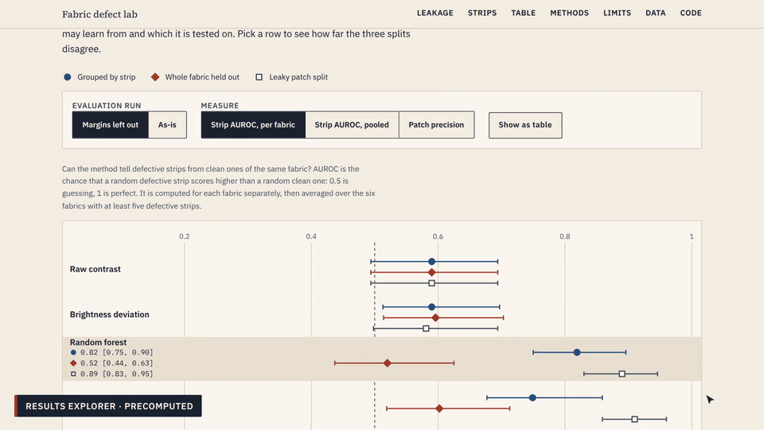
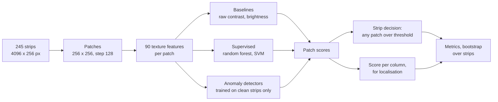
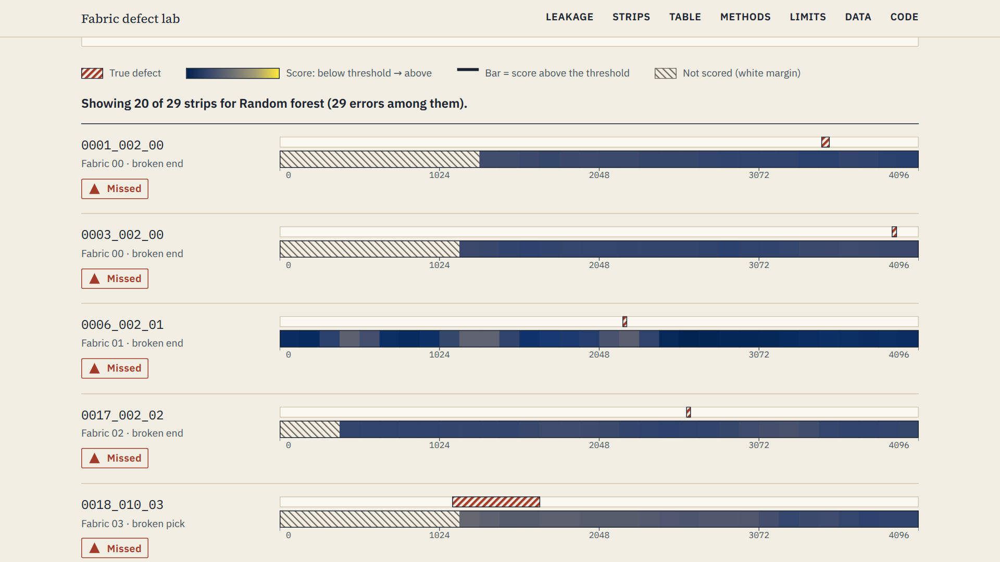

# fabric-defect-anomaly-detection

[](https://github.com/Dhairya233/fabric-defect-anomaly-detection/actions/workflows/ci.yml)
[](LICENSE)

**How much does the way you split your data change the result? A leak-aware study of
classical fabric defect detection on the public AITEX dataset.**

**Live results explorer: <https://dhairya233.github.io/fabric-defect-anomaly-detection/>**



## Why I built this

I built this as a college project to learn how to evaluate machine-learning results
properly. Defect detection is a setting where a careless split looks fine, because patches
cut from one fabric strip overlap each other. So I compared a deliberately leaky split with
a split by whole strip and with whole fabrics held out, and I wrote tests that fail if a
strip ever sits on both sides of a split. The models are classical (texture features,
random forest, SVM, simple anomaly detectors); the point is the evaluation around them.

## Demo video

**[Watch the 99-second narrated walkthrough](docs/media/demo_web.mp4)** (opens in GitHub's
video player; a [vertical 32-second cut](docs/media/short_vertical_captioned.mp4) is there too).

Text version, in case the video does not play: the
[narration script](docs/media/voiceover_script.md), the [captions](docs/media/demo.srt) and
the [screenshots](docs/media/screenshots/). The narration is synthetic speech.

## The headline finding

On the 245 strips of the AITEX dataset, a random split of patches **overstated a random
forest's patch-level precision by 0.44** (95% interval 0.27 to 0.53) compared with splitting
by whole strip, and **by 0.64** (0.46 to 0.75) compared with holding a whole fabric out. At
strip level the same leak overstated the per-fabric AUROC by 0.07 (0.02 to 0.12) and 0.37
(0.27 to 0.47). Anomaly detectors, which never see defects in training, showed no clear
inflation. With a whole fabric held out, every method scored close to chance (0.47 to 0.60
strip AUROC).

| Method | Measure | By strip | Whole fabric held out | Leaky patch split | Leaky minus by strip | Leaky minus unseen fabric |
|---|---|---|---|---|---|---|
| Random forest | Patch precision | 0.23 [0.16, 0.38] | 0.04 [0.03, 0.06] | 0.68 [0.50, 0.80] | +0.44 [+0.27, +0.53] | +0.64 [+0.46, +0.75] |
| Random forest | Strip AUROC, per fabric | 0.82 [0.75, 0.90] | 0.52 [0.44, 0.62] | 0.89 [0.83, 0.95] | +0.07 [+0.02, +0.12] | +0.37 [+0.27, +0.47] |
| SVM (RBF) | Patch precision | 0.28 [0.18, 0.42] | 0.04 [0.03, 0.06] | 0.50 [0.36, 0.65] | +0.23 [+0.11, +0.32] | +0.46 [+0.32, +0.60] |
| SVM (RBF) | Strip AUROC, per fabric | 0.75 [0.68, 0.86] | 0.60 [0.52, 0.71] | 0.91 [0.86, 0.96] | +0.16 [+0.07, +0.23] | +0.31 [+0.20, +0.40] |
| Mahalanobis, global | Patch precision | 0.12 [0.07, 0.25] | 0.07 [0.04, 0.10] | 0.11 [0.07, 0.20] | -0.01 [-0.06, +0.00] | +0.04 [+0.02, +0.11] |
| Mahalanobis, global | Strip AUROC, per fabric | 0.75 [0.68, 0.85] | 0.57 [0.46, 0.65] | 0.73 [0.66, 0.84] | -0.02 [-0.05, +0.01] | +0.17 [+0.10, +0.28] |
| Mahalanobis, per fabric | Patch precision | 0.13 [0.09, 0.20] | n/a | 0.14 [0.09, 0.22] | +0.01 [+0.00, +0.02] | n/a |
| Mahalanobis, per fabric | Strip AUROC, per fabric | 0.79 [0.72, 0.89] | n/a | 0.81 [0.75, 0.91] | +0.03 [-0.01, +0.06] | n/a |

Values are point estimates with 95% intervals from resampling whole strips (1,000
resamples); the last two columns are paired differences. 0.5 is chance for AUROC; random
ranking scores about 0.05 for patch precision (335 of 6,451 labelled patches are defective).
Source: [`results/margin_masked/`](results/margin_masked/), run with margin patches left out
(see [the data caveats](#honest-limits)).

## Methods in plain language



- **Features** (90 per patch): grey-level co-occurrence statistics, local binary patterns,
  Gabor filter responses, Fourier band energies and intensity moments. Each strip is first
  normalised to a robust z-score so the features describe texture, not one fabric's
  brightness.
- **Supervised** models (random forest, RBF SVM) learn from labelled patches.
- **Anomaly detectors** (Mahalanobis distance globally or per fabric, isolation forest,
  one-class SVM) are fitted on defect-free strips only and score how unlike normal fabric a
  patch looks.
- **Baselines** (raw contrast, brightness deviation) show how far a trivial rule gets.

### Evaluation protocol, and why it is leak-proof

- **Three splits.** *By strip*: all patches of a strip stay on one side (5-fold,
  stratified by fabric and clean or defective). *Whole fabric held out*: each fabric is the
  entire test side once. *Leaky patch split*: random patches, kept only as a control to
  measure inflation.
- **Three roles.** Train fits models; validation chooses thresholds and the one tuned
  setting (the SVM's C); test is scored once per configuration. Thresholds are chosen on
  validation patches only, and a test spies on the threshold function to prove it.
- **Tests** assert that no strip is on two sides, that a held-out fabric never appears in
  training or validation, and that the leaky split does leak (so the control is real).
- **Uncertainty** comes from resampling whole strips, not patches: patches of one strip are
  not independent, so patch-level intervals would be far too narrow.

## Results

Strip-level AUROC, averaged over the six fabrics with at least five defective strips
(0.5 is chance). Margin patches left out. Tested on 245 strips, 105 of them defective.

| Method | By strip | Whole fabric held out | Leaky patch split |
|---|---|---|---|
| Raw contrast | 0.59 [0.49, 0.69] | 0.59 [0.49, 0.69] | 0.59 [0.49, 0.69] |
| Brightness deviation | 0.59 [0.51, 0.70] | 0.60 [0.51, 0.70] | 0.58 [0.50, 0.69] |
| Random forest | 0.82 [0.75, 0.90] | 0.52 [0.44, 0.62] | 0.89 [0.83, 0.95] |
| SVM (RBF) | 0.75 [0.68, 0.86] | 0.60 [0.52, 0.71] | 0.91 [0.86, 0.96] |
| Mahalanobis, global | 0.75 [0.68, 0.85] | 0.57 [0.46, 0.65] | 0.73 [0.66, 0.84] |
| Mahalanobis, per fabric | 0.79 [0.72, 0.89] | n/a | 0.81 [0.75, 0.91] |
| Isolation forest | 0.70 [0.63, 0.81] | 0.55 [0.47, 0.64] | 0.68 [0.61, 0.80] |
| One-class SVM | 0.68 [0.61, 0.78] | 0.47 [0.37, 0.55] | 0.68 [0.60, 0.77] |

Per-fabric Mahalanobis needs a model for the fabric, so it cannot run on a fabric held out
of training. Baselines have no training, so they score the same under every split.

**On the three fabrics where clean and defective strips were captured alike** (03, 04, 06;
47 defective strips). This subset was chosen after looking at the data, so read it as a
sensitivity check:

| Method | By strip | Whole fabric held out | Leaky patch split |
|---|---|---|---|
| Raw contrast | 0.45 [0.33, 0.57] | 0.45 [0.33, 0.57] | 0.45 [0.33, 0.57] |
| Brightness deviation | 0.43 [0.31, 0.56] | 0.43 [0.30, 0.56] | 0.41 [0.28, 0.54] |
| Random forest | 0.74 [0.61, 0.85] | 0.59 [0.44, 0.72] | 0.84 [0.76, 0.91] |
| SVM (RBF) | 0.71 [0.58, 0.83] | 0.50 [0.36, 0.62] | 0.90 [0.82, 0.95] |
| Mahalanobis, global | 0.58 [0.46, 0.70] | 0.51 [0.40, 0.62] | 0.55 [0.44, 0.67] |
| Mahalanobis, per fabric | 0.62 [0.51, 0.74] | n/a | 0.64 [0.52, 0.77] |
| Isolation forest | 0.53 [0.43, 0.64] | 0.34 [0.23, 0.46] | 0.51 [0.40, 0.62] |
| One-class SVM | 0.45 [0.34, 0.56] | 0.46 [0.35, 0.58] | 0.42 [0.32, 0.53] |

Resampling *fabrics* instead of strips widens the unseen-fabric intervals a lot (random
forest 0.34 to 0.72), so with six fabrics the data cannot rule out a modest amount of
transfer. Details, per-fabric and per-defect-type tables: [docs/results.md](docs/results.md),
[docs/review.md](docs/review.md).

### Failure gallery



Each row is a strip the random forest missed. The hatched mark above the score track is the
true defect; the track is what the model scored (dark means below its threshold); the
hatched area is white margin that is not scored. No dataset images are shown.
[False alarms](docs/media/screenshots/04-failure-gallery-false-alarms.png) are in the same
explorer.

### Honest limits

- One small dataset: 245 strips, 7 fabrics, 105 defective strips (one fabric has a single
  defective strip). Nine of twelve defect types have fewer than ten examples.
- One public benchmark, captured in a lab. **Not tested on a factory line**; nothing here
  measures speed on real footage.
- The data has capture artefacts. 204 of 245 strips have blank white margins, and in four
  fabrics the clean and defective strips differ in overall brightness for reasons unrelated
  to defects (a brightness-only rule reaches 0.83 AUROC within fabric 01). I report a run
  with margin patches left out next to the as-is run; the brightness difference cannot be
  removed.
- The intervals cover which strips were drawn, not a different random fold assignment
  (the random forest moves by about 0.02 across five assignments, the SVM by about 0.05).
- Localisation is coarse by design: scores exist per 256-pixel patch while the median
  defect covers about 280 pixels.
- No deep pretrained features (I could not download weights in my environment), which is
  the most important missing comparison.
- Some analysis choices came after seeing results (the margin-masked run, the three-fabric
  subset); they are listed in [docs/review.md](docs/review.md).

## Dataset and licence

Data: the **AITEX Fabric Image Database (AFID)**, <https://www.aitex.es/afid/>. 245
grayscale images of 7 fabrics, 4096 x 256 px, 140 defect-free and 105 defective, with
pixel masks. **The dataset page states no licence**, so this repository contains no dataset
images and the site shows none; you download the data yourself. Please cite:

> J. Silvestre-Blanes, T. Albero-Albero, I. Miralles, R. Pérez-Llorens, J. Moreno.
> "AFID: a public fabric image database for defect detection." *AUTEX Research Journal*,
> No. 4, 2019.

The archives hold two files that do not match the dataset description (a 21st clean image
for one fabric and a defective image with an unknown fabric code); they are excluded and
documented in [docs/data_audit.md](docs/data_audit.md).

## Reproduce it

Tested with Python 3.12. Needs about 400 MB of disk; the full pipeline ran on one CPU core
within 4 GB of memory. Run every command from the repository root.

```bash
git clone https://github.com/Dhairya233/fabric-defect-anomaly-detection.git
cd fabric-defect-anomaly-detection
python -m venv .venv
source .venv/bin/activate            # Windows: .venv\Scripts\activate
pip install -r requirements.txt
pip install -e .

# 1. Download Defect_images.7z, NODefect_images.7z and Mask_images.7z from
#    https://www.aitex.es/afid/ into data/archives/ (create the folder), then:
python scripts/download_data.py      # verifies checksums, extracts
python scripts/prepare_data.py       # expect 140 clean and 105 defective

# 2. Features and margin analysis (about 15 minutes on one core)
python scripts/extract_features.py
python scripts/find_margins.py

# 3. Experiments (about 30 minutes each, mostly the bootstrap)
python scripts/run_experiments.py                                   # as-is -> results/
python scripts/run_experiments.py --mask-margins --out results/margin_masked --tag _margin
python scripts/artefact_check.py --out results/margin_masked
python scripts/make_figures.py --results results/margin_masked --predictions data/cache/predictions_margin.npz
python scripts/build_site_data.py    # regenerates the JSON the site reads

# 4. Look at the site
python -m http.server -d site 8000   # then open http://localhost:8000
```

Each script stops with a one-line instruction if a step before it has not been run. To
rebuild the demo video, GIF and screenshots see [docs/media/README.md](docs/media/README.md).

### Tests

```bash
pip install -r requirements.txt && pip install -e .
pytest              # unit tests on synthetic data; no dataset needed
ruff check . && ruff format --check .
```

The tests cover split integrity, patch geometry, the bootstrap and metrics, threshold
selection, the margin analysis, that the numbers quoted in this README match the result
tables, and that the site data matches them too. GitHub Actions runs them on every push.

### Project structure

```
src/fabricdefect/    dataset facts, loading, patching, features, models, splits,
                     evaluation, margins, reporting
scripts/             one command per step (download, prepare, extract, run, figures, ...)
tests/               unit tests on synthetic data, plus checks tying text to tables
results/             result tables and figures; margin_masked/ is the run to read first;
                     review/ holds the experiments behind docs/review.md
docs/                data audit, patching and splits, results, review; media/ holds
                     the GIF, screenshots, captions and narration script
site/                static results explorer (HTML, CSS, JavaScript, fonts, JSON)
media/               scripts and templates that build the demo video and screenshots
data/                git-ignored; see data/README.md
.github/workflows/   CI (lint and tests) and the GitHub Pages deploy
```

## Design decisions and trade-offs

- **Split by whole strip, not by patch.** Overlapping patches of one strip share pixels;
  that is the leak this project measures.
- **Patches of 256 px with a 128 px step.** Overlap means a defect up to 128 px wide lies
  wholly inside some patch. A patch is defective with at least 5 mask pixels: a study on the
  real masks showed a 25-pixel rule would leave 28 of 105 defective strips with no
  defective patch ([`results/patch_label_threshold.csv`](results/patch_label_threshold.csv)).
- **Bootstrap strips, report per fabric.** Pooled AUROC mostly rewards recognising which
  fabric a strip is, so per-fabric AUROC is the primary number.
- **A static, precomputed site instead of a live model.** It cannot claim more than the
  held-out numbers support, needs no server, and shows no dataset images.
- **Classical methods only.** They are cheap and inspectable, which keeps attention on the
  evaluation; the cost is that deep features are untested.

**Roadmap:** pretrained deep features (a PatchCore-style baseline); a second dataset; a
fold-assignment bootstrap; masking the dark edge bands next to some margins.

## Licence and third-party notices

- **Code:** MIT, see [LICENSE](LICENSE).
- **Dataset:** AITEX AFID, no licence stated, not redistributed here; citation above.
- **Fonts** (Source Serif 4, IBM Plex Sans, IBM Plex Mono): SIL Open Font License 1.1,
  self-hosted in `site/fonts/` with their licence texts.
- **Demo narration:** synthesised locally with Kokoro-82M (Apache-2.0), voice `af_heart`.
- **Music:** none in the repository; the demo video uses an original generated pad
  ([media/MUSIC.md](media/MUSIC.md), [media/CREDITS.md](media/CREDITS.md)).
- **Pretrained weights, icons, photographs:** none used.
- Python libraries keep their own licences (NumPy, SciPy, pandas, scikit-learn,
  scikit-image, matplotlib, Pillow, py7zr).
